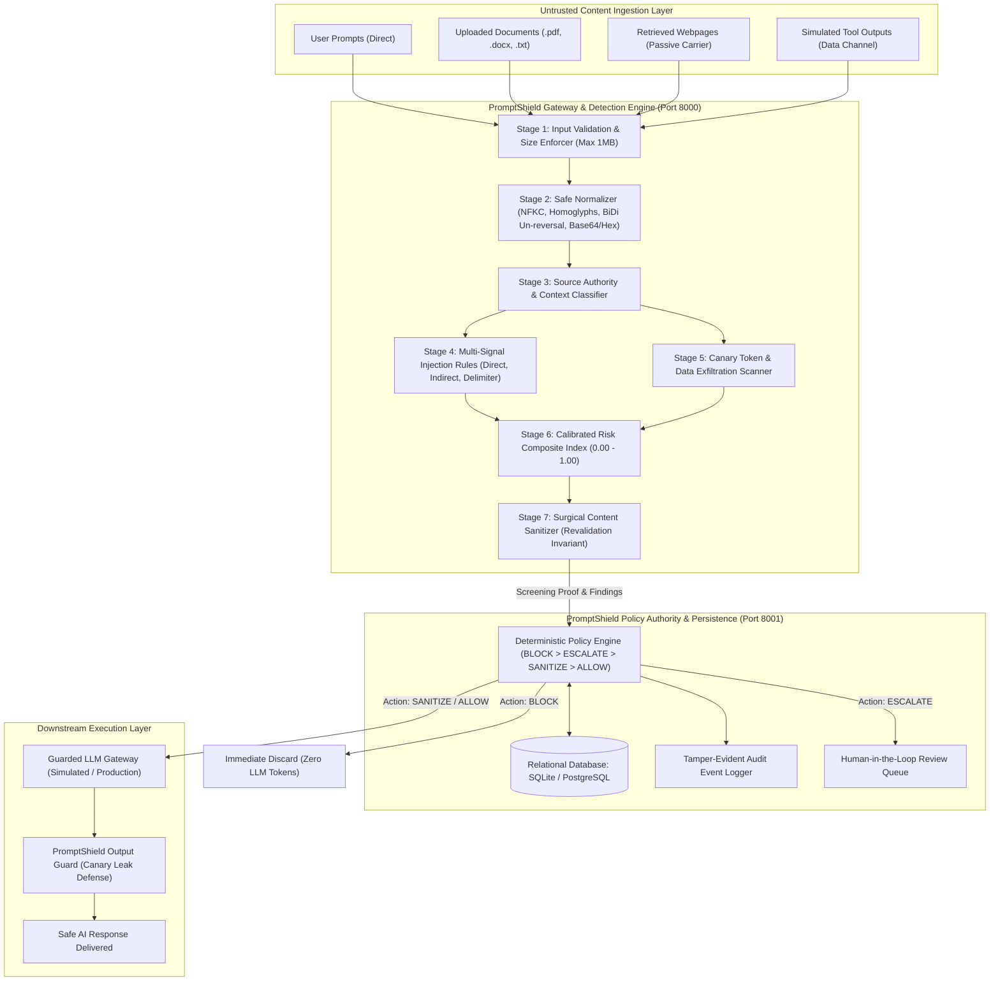
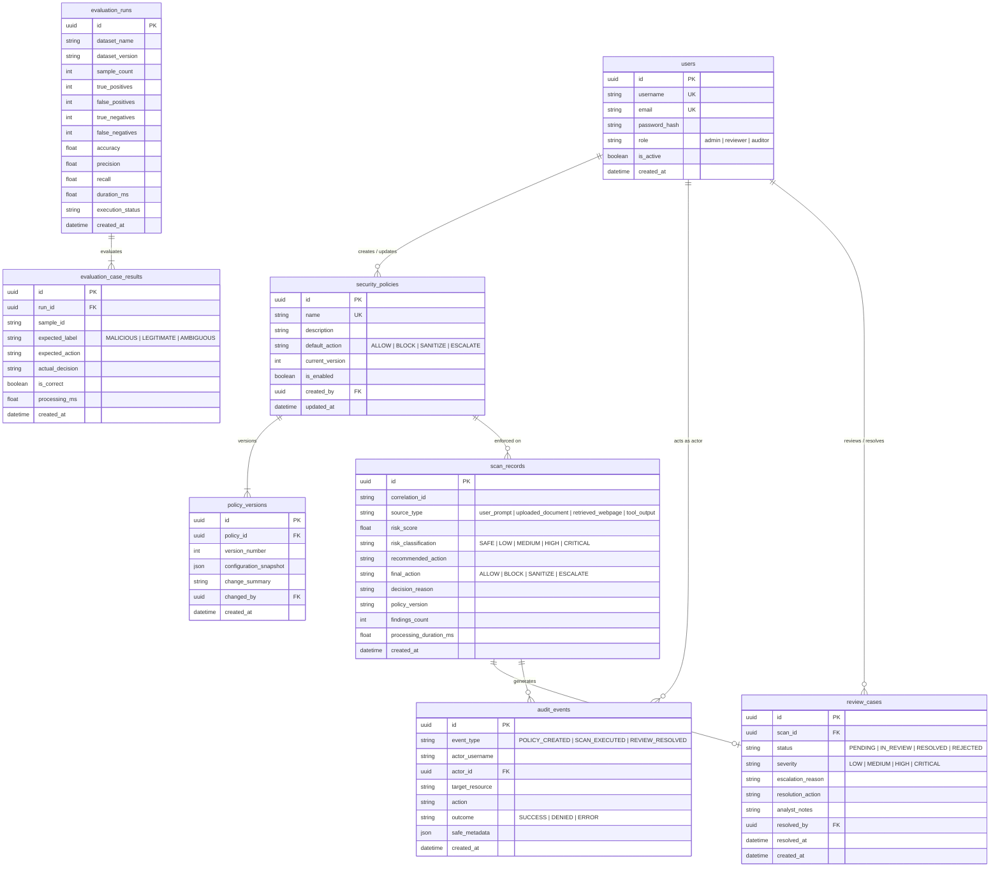

# PromptShield Architecture & Technical Specification
**Domain**: Cybersecurity & Digital Trust (SIH Track C-03)  
**System**: PromptShield Enterprise AI Defense Middleware  
**Version**: 1.3.0  

---

## 1. System Overview & Component Topology

PromptShield is architected as a high-assurance, decoupled defensive middleware layer positioned between untrusted external data sources and downstream Large Language Model (LLM) execution environments.

---

## 2. Relational Database Entity-Relationship Diagram (ERD)

PromptShield models users, security policies, immutable version snapshots, scan telemetry, review cases, evaluation runs, and audit logs with strict foreign key integrity and performance indexes.

---

## 3. The 6-Layer Security Detection Architecture

### Layer 1: Input Validation and Source Classification
- **Size Bounds**: Strict rejection of payloads $>1\,\text{MB}$ ($1,048,576$ bytes) before any parsing or memory allocation to mitigate DoS/memory exhaustion.
- **Source Classification**: Explicit classification into four distinct trust boundaries:
  1. `user_prompt` (Conversational prompt typed by user; direct threat vector).
  2. `uploaded_document` (Passive data carrier; sanitized when safe).
  3. `retrieved_webpage` (External web retrieval; high-vigilance indirect injection).
  4. `tool_output` (Simulated external tool or DB output; data only, never executive commands).
- **Untrusted Metadata Barrier**: Client-supplied metadata is sanitized. Provenance metadata is strictly stamped server-side.

### Layer 2: Safe Normalization Pipeline
- **Unicode NFKC**: Canonical compatibility decomposition and composition to defeat unicode evasion.
- **Homoglyph Folding**: Deterministic folding of Cyrillic, Greek, and fullwidth lookalikes into Latin ASCII equivalents.
- **BiDi Directional Override Defense**: Un-reversal of text spans enclosed by Unicode Right-to-Left Override (`\u202E` RLO) and Pop Directional Formatting (`\u202C` PDF).
- **Zero-Width Stripping**: Removal of zero-width spaces, joiners, and byte-order marks (`\u200B`, `\u200C`, `\u200D`, `\uFEFF`).
- **Bounded Auxiliary Channels**: Safe decoding of Base64 and Hex payloads without code execution, capped at 3 recursion passes.

### Layer 3: Context-Aware Detection
- **Multi-Signal Rules**: High-precision regex engines with negative lookahead for academic/benign context (e.g. SQL injection tutorials, firewall rule updates).
- **Delimiter Injection**: Detection of forged model boundaries (ChatML `<|im_start|>system`, Llama `[INST]`, Alpaca `### Instruction:`).
- **Canary Scanner**: Flexible regex matching detecting synthetic test secrets (`CANARY_VORTEXA_SEC_7749`, `SYNTHETIC_API_KEY_123`, AWS/GitHub keys) across case variations, arbitrary spacing, leetspeak (`c4n4ry`), and ROT13.
- **Exfiltration Channels**: Detection of unauthorized external C2 addresses, SSRF link-local metadata endpoints (`169.254.169.254`), and markdown exfiltration channels (``).

### Layer 4: Deterministic Policy Engine
- **Precedence Hierarchy**:
  $$\mathbf{BLOCK} \succ \mathbf{ESCALATE} \succ \mathbf{SANITIZE} \succ \mathbf{ALLOW}$$
  An allow rule or benign signal can *never* override a confirmed critical threat.
- **Policy Immunity**: Untrusted content parsed from documents or prompts cannot modify server security policies. Policy edits require authenticated, role-authorized API calls.

### Layer 5: Surgical Sanitization & Revalidation Invariant
- **Span Excision**: Offending injection spans are cleanly removed from passive carriers, preserving unrelated business text.
- **Revalidation Invariant**: Sanitized output is passed back through Normalization and Rule matching before downstream delivery. If any threat signal persists, the action is automatically upgraded to `BLOCK`.

### Layer 6: Tamper-Evident Audit & Secret Redaction
- **Zero Raw Secrets**: Canary tokens, passwords, and API keys are redacted before persistence.
- **Append-Only Logging**: Every evaluation, policy snapshot, and analyst decision generates an immutable record in `audit_events`.
