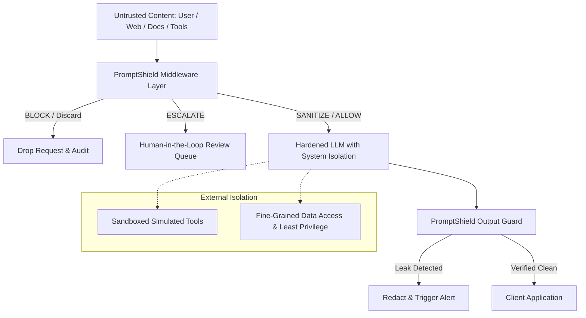

# PromptShield: Limitations and Future Scope
**Domain**: Cybersecurity & Digital Trust (SIH Track C-03)  
**System**: PromptShield Enterprise AI Defense Middleware  
**Date**: October 2026  

---

## 1. Technical Limitations of Middleware-Only Screening

While PromptShield provides comprehensive, low-latency pre-execution defense, modern AI security theory recognizes that no single defensive boundary can guarantee 100% immunity in isolation.

### 1.1 Fundamental Middleware Boundary
- **Semantic Ambiguity**: In natural language, distinguishing between a benign hypothetical question ("Explain how prompt injections bypass delimiters") and an adversarial test requires intent inference. PromptShield addresses this using context-aware heuristics and the `ESCALATE` action for human review, but highly sophisticated, multi-turn indirect injections across long conversation histories can introduce edge cases.
- **In-Model Vulnerabilities**: Middleware screens inputs and simulated tool outputs *before* the LLM. If the downstream model's internal weights or fine-tuning are inherently vulnerable to subtle jailbreak tokens or steganographic encodings that appear syntactically indistinguishable from benign prose, defense-in-depth is required at the model layer (system prompts, constitutional AI, output guards).
- **Multi-Turn State Tracking**: In multi-turn chat sessions, attacks may be fragmented across dozens of conversational turns (Crescendo attacks). While individual turns appear harmless, the cumulative state builds towards an instruction override.

### 1.2 Resource and Decompression Bounds
- **Bounded Normalization Depth**: To protect against Denial-of-Service (DoS) and Regular Expression Denial of Service (ReDoS), recursive unwrapping of nested Base64, Hex, and URL encodings is capped at 3 recursion passes.
- **Document Payload Caps**: Uploaded documents are restricted to 10 MB raw file size and 1 MB extracted text. Documents exceeding this size are rejected to prevent memory exhaustion and zip-bomb attacks.
- **In-Memory Parsing**: Document parsing occurs in volatile memory (`io.BytesIO`) without disk persistence. Extremely large multi-thousand-page PDFs must be processed in chunks.

---

## 2. Security Defense-in-Depth Architecture

To mitigate middleware limitations, enterprise deployments should combine PromptShield with the following complementary controls:

1. **Principle of Least Privilege**: Downstream tools should execute with scoped permissions; databases should enforce row-level security and read-only replicas.
2. **Strict Output Verification**: All LLM responses must pass through PromptShield's `OutputGuard` to prevent canary secret leakage, SSRF URLs, or reflected injection commands.
3. **Network Isolation & SSRF Filtering**: Tools and retrievers must not have access to link-local addresses (`169.254.169.254`) or internal service endpoints.

---

## 3. Future Scope & Engineering Roadmap

### Phase 1: Machine Learning & Semantic Embeddings (v1.4.0)
- **Local Small-Language-Model (SLM) Classifier**: Integrate a fine-tuned, quantized 0.5B parameter ONNX-runtime classifier (e.g., Llama-Guard / DeBERTa-v3) running locally with `<10ms` inference to supplement regex and heuristic rules.
- **Vector Semantic Similarity**: Index known prompt injection taxonomies (OWASP Top 10 for LLMs) using lightweight local embeddings (MiniLM-L6) for cosine similarity anomaly scoring.

### Phase 2: Multi-Turn Conversation State & Crescendo Defense (v1.5.0)
- **Session Trajectory Graph**: Track conversational drift across turns. Calculate rolling risk entropy scores to detect gradual privilege escalation and multi-turn persona poisoning.
- **Distributed Token Bucketing**: Implement per-tenant token velocity limits and dynamic risk thresholds that tighten automatically when suspicious probing is detected.

### Phase 3: Hardware Security Module (HSM) & KMS Integration (v2.0.0)
- **KMS-Managed Canary Secrets**: Automatically rotate dynamic synthetic canary tokens every 60 minutes via AWS KMS, GCP Cloud KMS, or HashiCorp Vault.
- **Cryptographic Audit Signatures**: Sign every entry in `audit_events` with an ed25519 asymmetric key to guarantee non-repudiation in legal and compliance audits (SOC 2, ISO 27001, HIPAA).

### Phase 4: Enterprise Tool Sandboxing & Agent Guardrails (v2.1.0)
- **WebAssembly (WASM) Tool Isolation**: Run simulated tools and document parsers inside lightweight WASM sandboxes to enforce strict memory and syscall boundaries.
- **Bidirectional MCP Guard**: Screen Model Context Protocol (MCP) tool requests and responses against PromptShield policy before execution.
